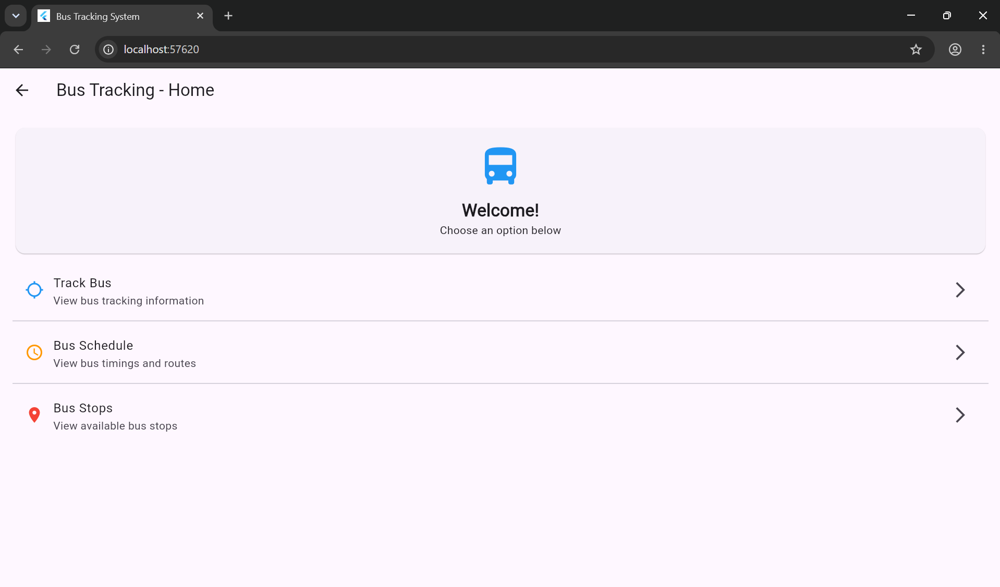
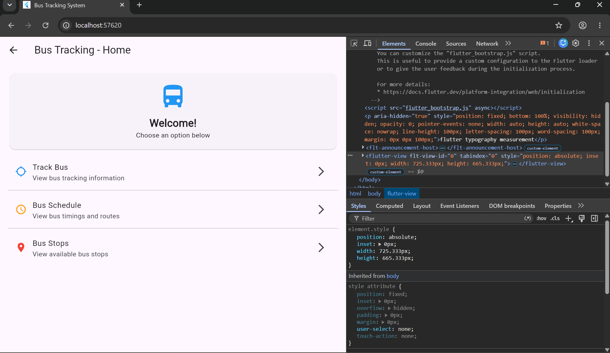
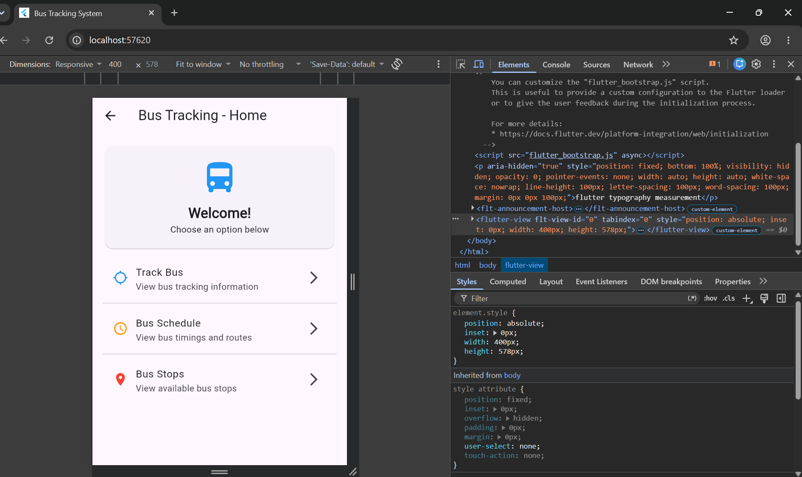
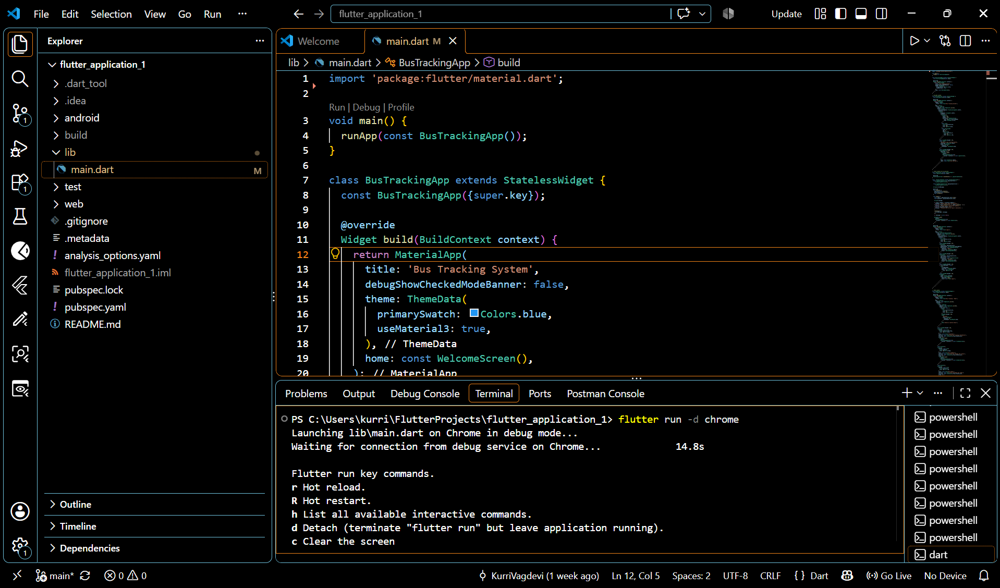
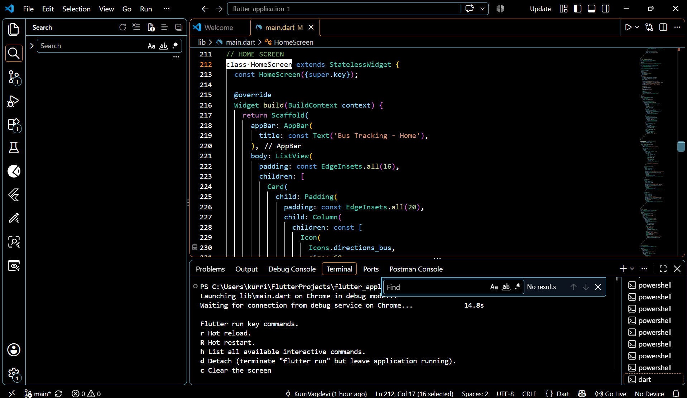
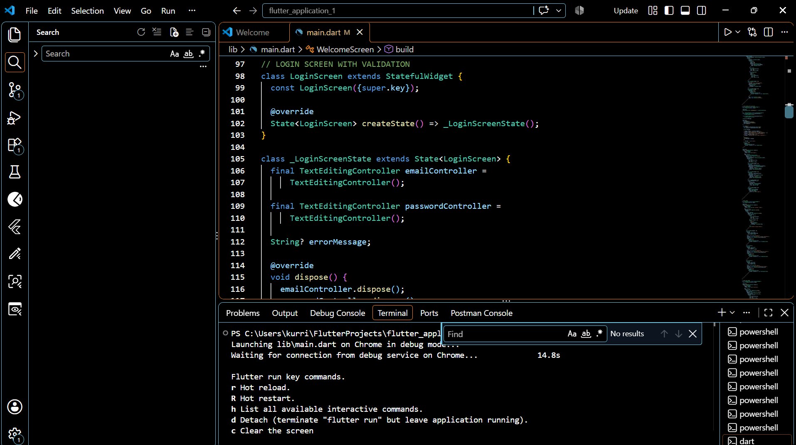
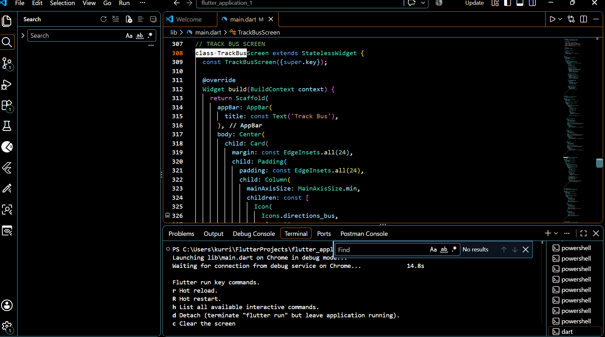
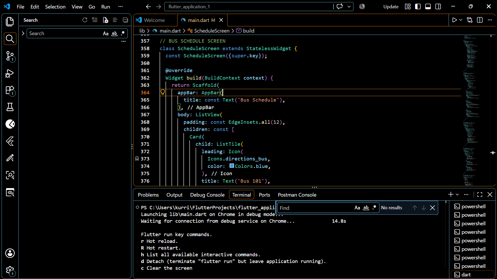
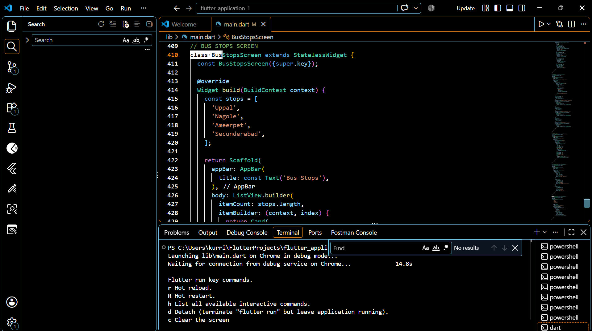

# 🚌 Bus Tracking System

## 📌 About the Project

The **Bus Tracking System** is a Flutter-based application designed to help users access bus tracking information, bus schedules, and bus stop details through a simple and user-friendly interface.

The application includes a welcome screen, login screen, home screen, bus tracking screen, and bus schedule screen.

## ✨ Features

- **Welcome Screen:** Introduction to the Bus Tracking System.
- **Login Screen:** Email and password input interface.
- **Home Screen:** Easy navigation to the available features.
- **Track Bus:** Displays bus information and route status.
- **Bus Schedule:** Shows bus timings and routes.
- **Bus Stops:** Screenshots and interface documentation for the project.

**Note:** Live GPS tracking and real-time bus locations are not connected yet.

## 🛠️ Technologies Used

- Flutter
- Dart
- Material Design
- Visual Studio Code

## 📸 Application Screenshots

### 1. Home Screen — Desktop

### 2. Home Screen — Laptop

### 3. Home Screen — Phone

## 💻 Code Screenshots

### Main Dart Code

### Home Screen Code

### Login Screen Code

### Track Bus Screen Code

### Bus Schedule Screen Code

### Bus Stops Screen Code

## 🚀 How to Run the Project

1. Install Flutter SDK.
2. Clone or download this repository.
3. Open the project folder in Visual Studio Code.
4. Run `flutter pub get`.
5. Run `flutter run`.

## 🎯 Project Objective

The objective of this project is to develop a simple bus information application using Flutter and demonstrate screen design, navigation, and bus schedule presentation.

---

**Project:** Bus Tracking System  
**Framework:** Flutter  
**Language:** Dart
