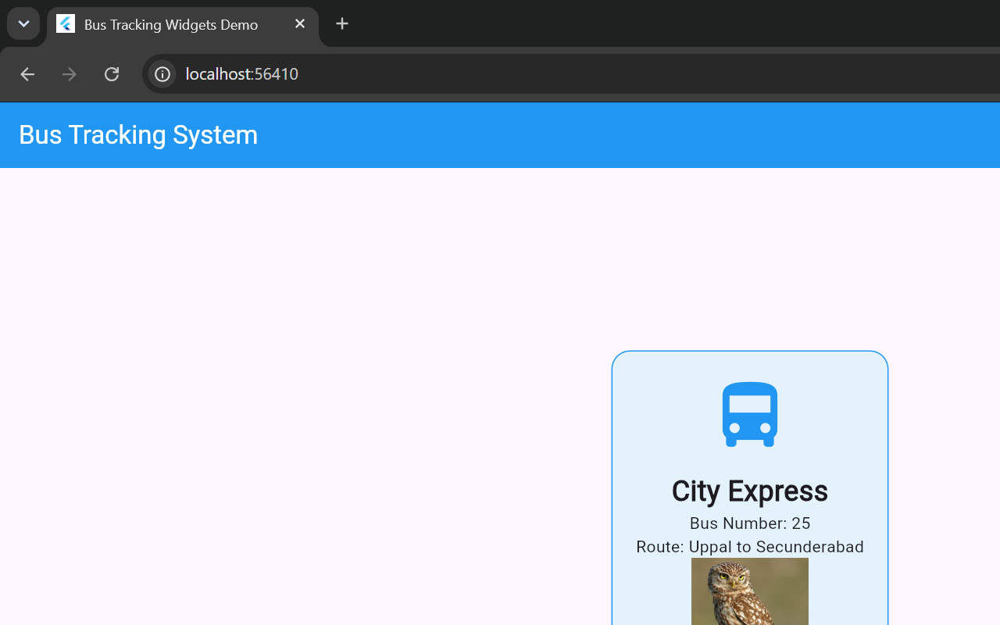

# 🚌 Bus Tracking System

A Flutter-based bus information application built to demonstrate UI design, navigation, responsive layouts, and bus schedule presentation.

## 📌 About the Project

The Bus Tracking System provides a simple interface for exploring bus information, routes, schedules, and bus stops.

The project includes application screens and Flutter lab experiments that demonstrate core Flutter and Dart concepts.

## ✨ Features

- 🏠 Welcome and Home screens
- 🔐 Login screen UI
- 🚌 Bus tracking screen UI
- 🕒 Bus schedules and route information
- 📍 Bus stop interface
- 📱 Responsive UI experiments
- 🧭 Navigation and named routes
- 🎨 Custom widgets and themes
- ✨ Animation demonstrations
- 🌐 REST API and data display experiments
- 🧪 Unit testing and debugging exercises

> **Note:** Live GPS tracking and real-time bus location services are not connected yet.

## 🛠️ Technologies Used

- Flutter
- Dart
- Material Design
- Visual Studio Code
- Provider
- HTTP

## 📸 Application Screenshots

### Flutter Widgets Demo



### Other Application Screenshots

The following screenshots are referenced in this project, if available:

- `lib/screenshots/home_desktop.png`
- `lib/screenshots/home_laptop.png`
- `lib/screenshots/home_phone.png`

## 📚 Flutter Lab Experiments

| Experiment | File | Run command |
|---|---|---|
| Dart Basics | `lib/bus_basics.dart` | `dart run lib/bus_basics.dart` |
| Flutter Widgets | `lib/widgets_demo.dart` | `flutter run -t lib/widgets_demo.dart` |
| Layouts | `lib/layouts_demo.dart` | `flutter run -t lib/layouts_demo.dart` |
| Responsive UI | `lib/responsive_demo.dart` | `flutter run -t lib/responsive_demo.dart` |
| Navigation | `lib/navigation_demo.dart` | `flutter run -t lib/navigation_demo.dart` |
| Named Routes | `lib/named_routes_demo.dart` | `flutter run -t lib/named_routes_demo.dart` |
| Stateful Widgets | `lib/state_widgets_demo.dart` | `flutter run -t lib/state_widgets_demo.dart` |
| Provider | `lib/provider_demo.dart` | `flutter run -t lib/provider_demo.dart` |
| Custom Widgets | `lib/custom_widgets_demo.dart` | `flutter run -t lib/custom_widgets_demo.dart` |
| Themes | `lib/themes_demo.dart` | `flutter run -t lib/themes_demo.dart` |
| Forms | `lib/form_demo.dart` | `flutter run -t lib/form_demo.dart` |
| Validation | `lib/validation_demo.dart` | `flutter run -t lib/validation_demo.dart` |
| Animations | `lib/animation_demo.dart` | `flutter run -t lib/animation_demo.dart` |
| Fade and Slide | `lib/fade_slide_demo.dart` | `flutter run -t lib/fade_slide_demo.dart` |
| REST API | `lib/api_fetch_demo.dart` | `flutter run -t lib/api_fetch_demo.dart` |
| Display API Data | `lib/api_display_demo.dart` | `flutter run -t lib/api_display_demo.dart` |
| Unit Testing | `test/bus_ui_test.dart` | `flutter test test/bus_ui_test.dart` |
| Debugging | `lib/debugging_demo.dart` | `flutter run -t lib/debugging_demo.dart` |

## 🚀 How to Run the Project

1. Install the Flutter SDK.
2. Clone this repository:

   ```bash
   git clone https://github.com/KurriVagdevi/Bus-Tracking-System.git
   ```

3. Open the project folder in Visual Studio Code.
4. Install dependencies:

   ```bash
   flutter pub get
   ```

5. Run the main application:

   ```bash
   flutter run
   ```

To run the widgets demonstration separately:

```bash
flutter run -t lib/widgets_demo.dart
```

## 🎯 Project Objective

To demonstrate Flutter application development through UI design, widgets, layouts, navigation, responsive design, state management, animations, API integration exercises, and testing.

## 👩‍💻 Project Information

- **Project:** Bus Tracking System
- **Framework:** Flutter
- **Language:** Dart
- **Repository:** [GitHub](https://github.com/KurriVagdevi/Bus-Tracking-System)
